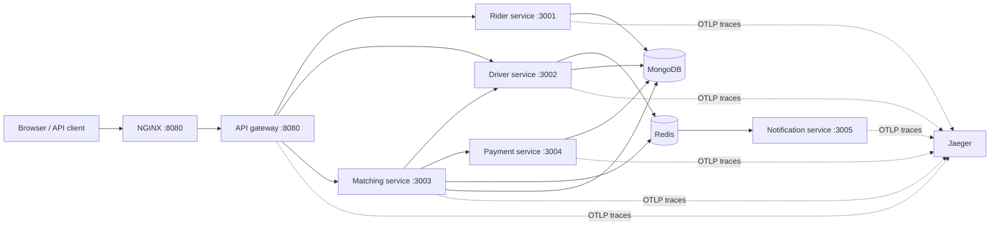

# Vantra

Vantra is a ride-hailing demo built to explore distributed-system patterns: service boundaries,
geospatial driver matching, an orchestrated booking saga, idempotency, circuit breakers, Redis
Streams, and distributed tracing with OpenTelemetry and Jaeger.

> **Scope:** This is a learning/demo project, not a production-ready ride-hailing platform.
> Payment is simulated, and the local Docker Compose stack uses single-instance MongoDB, Redis,
> and Jaeger.

## What is included

- A React + Vite web app for riders, drivers, and service/failure dashboards.
- Six Node.js services (the API gateway plus five domain services), with NGINX in front.
- MongoDB for persistent service data; Redis for live driver locations, locks, rate limits,
  token revocation, and notification events.
- OpenTelemetry traces exported to Jaeger, including saga steps and compensation spans.
- Docker Compose for local development and Kubernetes manifests under `k8s\` for a local cluster.

## Architecture



| Component | Port | Responsibility |
|---|---:|---|
| NGINX | 8080 (host) | Public entry point; forwards HTTP and Socket.IO traffic to the gateway. |
| API gateway | 8080 (container) | JWT checks, rate limiting, request identity/correlation headers, and routing. |
| Rider service | 3001 (container) | Rider accounts and ride requests/history. |
| Driver service | 3002 (container) | Driver accounts, availability, location, and assignment. |
| Matching service | 3003 (container) | Nearby-driver offers, ride state, and booking saga orchestration. |
| Payment service | 3004 (container) | Simulated, idempotent authorization/capture/void/refund operations. |
| Notification service | 3005 (container) | Redis Stream consumer and Socket.IO notifications. |
| MongoDB / Redis | 27017 / 6379 (container-only) | Persistent records / live state and coordination. |
| Jaeger UI | 16686 (host) | Search and inspect distributed traces. |

Services use separate databases/collections and communicate through HTTP. Redis Streams carry
notification events; booking correctness is coordinated by the matching service's saga.
See [ARCHITECTURE.md](./ARCHITECTURE.md) for design decisions and trade-offs.

## Requirements

- Node.js 22 or newer for local scripts, tests, and the frontend.
- Docker Desktop (or Docker Engine) with Docker Compose v2.
- Optional for Kubernetes: `kubectl` and either `kind` or `minikube`. The helper
  `k8s\create-secret.sh` requires Bash (for example, Git Bash or WSL on Windows).

## Run locally with Docker Compose

From the project root:

```powershell
node .\scripts\make-env.js
docker compose up --build -d
docker compose ps
```

The env script creates `.env` with random `JWT_SECRET` and `INTERNAL_API_KEY` values and leaves
an existing `.env` unchanged. The Compose stack builds and starts the services, MongoDB, Redis,
Jaeger, and NGINX.

- API health: <http://localhost:8080/health>
- Jaeger UI: <http://localhost:16686>

Check service output with `docker compose logs -f matching-service` (replace the service name as
needed). Stop the stack with `docker compose down`. Data is kept in named volumes; **only run
`docker compose down -v` if you intend to delete the local MongoDB and Redis data**.

### Run the web app

The frontend is not part of the Compose stack. With the backend running, use a second terminal:

```powershell
npm --prefix .\frontend ci
npm --prefix .\frontend run dev
```

Open <http://localhost:5173>. Vite proxies `/api`, `/health`, and `/status` to the local gateway
on port 8080.

## Jaeger: generate and inspect traces

Compose starts Jaeger with OTLP/HTTP collection enabled. Each backend service exports spans to
`http://jaeger:4318` inside the Compose network; the Jaeger UI is published on port 16686.

1. Start the stack and confirm `http://localhost:8080/health` responds successfully.
2. Generate traffic, for example by running the end-to-end scenarios:

   ```powershell
   node .\tests\e2e.js
   ```

3. Open <http://localhost:16686>, select `api-gateway` or `matching-service` as the service, and
   choose **Find Traces**.
4. Open a trace and expand its spans. A booking trace can include `saga.run`,
   `saga.step.*`, `saga.compensate.*`, and downstream HTTP/database spans. A driver's later
   accept request is a separate trace, linked in the trace data by the ride ID.

To see an outage and recovery, run `node .\scripts\demo-payment-down.js` while the stack is up
and `DEMO_MODE=true`. It stops and restarts the local `payment-service`, makes test bookings,
and prints circuit-breaker and compensation results. You can inspect the resulting traces in
Jaeger and service health at <http://localhost:8080/status>.

Jaeger here is configured for local development; use an appropriately secured and durable
tracing backend for a real deployment.

## Tests and checks

Run the local checks that do not require Docker:

```powershell
npm run check
npm run test:unit
```

- `npm run check` checks JavaScript syntax, relative imports, declared service dependencies,
  and that generated `services\*\src\common` copies match `common\`.
- `npm run test:unit` runs the matching and notification service unit tests.
- `node .\tests\e2e.js` runs end-to-end scenarios against a running stack. It covers booking,
  driver matching, payment failure/compensation, idempotency, and other integrated flows.
- `node .\tests\e2e.js payment` runs scenarios whose names contain `payment`.
- `node .\scripts\demo-payment-down.js` exercises payment outage and breaker recovery against
  the local Compose stack.

The load test at `tests\load\booking.js` also needs the stack running and the `autocannon`
development dependency installed from `tests\package.json`.

The shared helper source of truth is `common\`. After changing a shared helper, run
`node .\scripts\sync-common.js` before the checks so each service's generated copy stays in sync.

## Configuration

Set local values in `.env`; do not commit secrets. `node .\scripts\make-env.js` creates safe
random secrets for a new local setup.

| Variable | Default | Purpose |
|---|---:|---|
| `JWT_SECRET` | generated | Signs and verifies rider/driver tokens. |
| `INTERNAL_API_KEY` | generated | Authenticates internal service requests. |
| `DEMO_MODE` | `true` | Enables demo endpoints and `/status`; disable outside demos. |
| `PAYMENT_FAILURE_RATE` | `0` | Fraction of simulated payment authorizations that fail (`0` to `1`). |
| `OFFER_TIMEOUT_SEC` | `15` | Time allowed for a driver to answer an offer. |
| `MAX_OFFER_ATTEMPTS` | `3` | Maximum drivers offered a ride. |
| `MAX_COMPENSATION_ROUNDS` | `5` | Compensation retries before a saga is marked failed. |
| `HEARTBEAT_TTL_SEC` | `30` | Driver location heartbeat lifetime. |
| `RATE_LIMIT_PER_MIN` | `600` | Gateway requests per minute per client IP. |

## Kubernetes (optional)

The `k8s\` directory contains manifests for the services, MongoDB, Redis, Jaeger, and an
optional ingress. This is intended for a local `kind` or `minikube` cluster, not a hardened
production environment.

1. Build each service image from the repository root and load it into the cluster:

   ```powershell
   $services = @("api-gateway", "rider-service", "driver-service", "matching-service", "payment-service", "notification-service")
   foreach ($service in $services) {
     docker build -t "vantra/$service:local" "services\$service"
     kind load docker-image "vantra/$service:local"
   }
   ```

   For Minikube, use `minikube image load "vantra/$service:local"` in the loop instead of the
   `kind load` command.

2. Create the Kubernetes secret from the local `.env` by running this from Git Bash or WSL
   at the repository root:

   ```bash
   bash ./k8s/create-secret.sh
   ```

   Then apply the manifests from PowerShell:

   ```powershell
   kubectl apply -f .\k8s
   ```

3. In separate terminals, forward the API and Jaeger UI ports:

   ```powershell
   kubectl -n vantra port-forward svc/api-gateway 8080:8080
   kubectl -n vantra port-forward svc/jaeger 16686:16686
   ```

For Minikube, enable its ingress add-on only if you want to use the optional ingress manifest.
The matching-service autoscaler also requires metrics-server.

## Repository map

```text
common\             Shared helper source copied into each service
services\           API gateway and five backend services
frontend\            React + Vite web application
tests\               Unit, end-to-end, and load tests
scripts\              Environment, shared-code sync, and demo utilities
k8s\                  Kubernetes manifests
nginx\                Compose reverse-proxy configuration
legacy-monolith\      Earlier monolithic implementation
ARCHITECTURE.md       Architecture decisions and trade-offs
```
